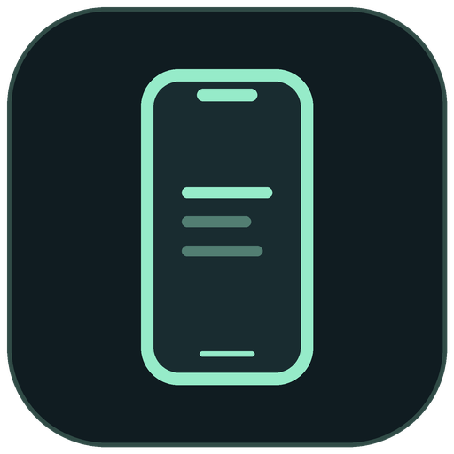

# iPhone Desktop



View and control your iPhone from a Windows PC over USB or Wi-Fi. A local desktop interface for iOS developer services powered by [pymobiledevice3](https://github.com/doronz88/pymobiledevice3).

**Version 0.2.0 · Preview · Windows 10/11 x64 · iOS 27 or later**

## Features

- Live screen viewing and mouse/keyboard input through the upstream WebCodecs viewer.
- USB and wireless RemotePairing connections on your local network.
- Guided device trust, Developer Mode, and developer service setup.
- Automatic developer image preparation, local diagnostics, and session cleanup.
- English interface. No Bluetooth transport, jailbreak, signed iPhone app, subscription, or application cloud relay.

## Requirements

- Windows 10/11 x64 and Python 3.13 for running from source or building.
- Chrome or Edge with WebCodecs and HEVC decoding available.
- **iOS 27 or later** for the streaming protocol in the pinned backend. Older versions are rejected before the viewer opens.
- Apple Devices or iTunes with Apple Mobile Device support for USB.
- A data-capable USB cable for initial trust and wireless setup.
- An unlocked, trusted iPhone with Developer Mode enabled.
- Internet access on the PC for the first developer image download.

## Run from source

```powershell
git clone https://github.com/andreazero/iphone-desktop.git
cd iphone-desktop
py -3.13 -m venv .venv
.\.venv\Scripts\python.exe -m pip install -r requirements.txt
.\.venv\Scripts\python.exe run.py
```

The app opens a Chrome or Edge application window. This source repository does not include a prebuilt executable.

## USB setup

1. Connect the data cable, unlock the iPhone, and accept **Trust This Computer** on the phone.
2. Enable **Settings → Privacy & Security → Developer Mode**. Restart and confirm on the phone. If the setting is missing, click **Setting missing?** to reveal it; the app does not enable it or restart the phone.
3. Select the device and click **Connect iPhone**. Developer services are prepared automatically, or separately with **Prepare services**. The first download may take several minutes. On iOS 27, preparation uses an RSD tunnel and a Cryptex1 developer image.
4. Try a harmless action, such as returning to the Home screen, to confirm input. Click and drag in the viewer to send touch input; follow the viewer's keyboard instructions.

## Wi-Fi setup

1. Complete USB trust and Developer Mode setup first.
2. With USB connected, click **Set up Wi-Fi while USB is connected**. This enables network connections and creates developer RemotePairing through trusted USB.
3. If discovery cannot find the phone, enter its local IPv4 address before setup: **Settings → Wi-Fi → ⓘ → IP Address**.
4. Disconnect USB, keep the phone unlocked, select **Wi-Fi**, refresh, and connect.

An Ethernet-connected PC and a Wi-Fi-connected phone can communicate on the same local network. Guest networks and client isolation may prevent connections. A saved IP is queried directly through Bonjour when multicast discovery is unavailable. If it changes, update it through USB setup. A cold scan may return no devices; refresh and try again.

## Build a portable Windows app

```powershell
.\.venv\Scripts\python.exe -m pip install -r requirements-build.txt
powershell -File scripts\build.ps1 -SkipDependencyInstall
```

Open `dist\iPhone Desktop\iPhone Desktop.exe`. Keep the entire distribution folder together; the executable cannot be moved on its own. `Start.cmd` launches the built app or source environment.

The build runs tests and collects dependency license notices. `requirements-lock.txt` records the resolved development/build environment; install it instead of the requirements files to reproduce those exact versions. The build preserves an existing distribution's `.runtime` folder. Remove personal runtime data from any package you share.

Windows and browser icons are in `iphone_desktop/web`. Install Pillow and run `scripts/generate_icons.py` to regenerate them.

## Development

```powershell
.\.venv\Scripts\python.exe -m unittest discover -s tests -v
```

The aiohttp server manages discovery, prerequisites, sessions, cancellation, and errors. Each device operation runs in an isolated worker. USB/RSD/HID protocols and the WebCodecs viewer come from pymobiledevice3 11.49.0, with upstream attribution preserved.

Application and streaming servers bind to `127.0.0.1`. App APIs check the session token, Host, and Origin; the upstream viewer applies its own origin checks. The viewer opens only after actual video codec configuration is received.

See [CONTRIBUTING.md](CONTRIBUTING.md) and [VALIDATION.md](VALIDATION.md) for contribution guidance and validation limits.

## Limitations and local data

- iOS developer protocols may change. Detection or a successful HTML response alone does not prove video or input support.
- Audio is unavailable in this Windows version; the upstream audio decoder requires macOS.
- Developer preparation may download Apple components and contact personalization services through pymobiledevice3. Screen frames and input use the PC and local device connection without an application relay.
- State, logs, and saved wireless addresses are in `.runtime` beside the app. They are not uploaded automatically and may contain device names and identifiers. Review before sharing.
- **Disconnect** stops the engine. **Quit** stops the application. Closing only the window stops the process after approximately two minutes without a heartbeat.

## License

Distributed under the [GNU General Public License v3.0](LICENSE). See [THIRD_PARTY.md](THIRD_PARTY.md) for component attribution and build notices.

An independent project, unaffiliated with Apple, Microsoft, or Google.
